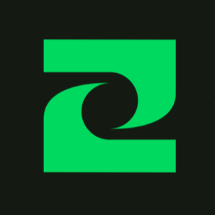
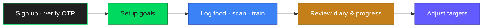

<p align="center">
  
</p>

<h1 align="center">Trackwise</h1>

<p align="center">
  <strong>Nutrition & fitness tracking — on your phone</strong><br/>
  <sub>Food diary · Barcode scan · Workouts · Goals · Progress</sub><br/>
  <sub>Free on Android · Estimates, not medical measurements</sub>
</p>

<p align="center">
  <a href="https://trackwise.one"></a>
  <a href="https://trackwise.one/#download"></a>
</p>

<p align="center">
  
  
  
  
  
  
</p>

<p align="center">
  <a href="#what-is-trackwise"></a>
  <a href="#key-features"></a>
  <a href="#getting-started"></a>
  <a href="#configuration"></a>
  <a href="https://trackwise.one/privacy"></a>
</p>

---

## What is Trackwise?

Trackwise is a **mobile-first** nutrition and fitness app. Log meals, scan barcodes, train from an exercise library, set personal goals, and review progress — in one place.

|                                                                                                                                 |                                                                                                                                   |                                                                                                                                     |                                                                                                                                    |
| ------------------------------------------------------------------------------------------------------------------------------- | --------------------------------------------------------------------------------------------------------------------------------- | ----------------------------------------------------------------------------------------------------------------------------------- | ---------------------------------------------------------------------------------------------------------------------------------- |
|  Calories & macros vs your targets |  Open Food Facts lookup — not AI OCR |  Library, templates, sets & estimated burn |  RLS-backed data · export / delete |

> **Who it’s for:** people who want everyday food and training awareness with clear estimates — not a medical device, and not AI meal recognition.

**Availability today:** free core tracking on **Android**. iOS is planned for later. Store listings appear on [trackwise.one](https://trackwise.one) when published.

---

## Key features

|                                                                                    | Area              | Highlights                                                                                                                                      |
| :--------------------------------------------------------------------------------: | ----------------- | ----------------------------------------------------------------------------------------------------------------------------------------------- |
|          | **Food diary**    | Log meals by search, recent foods, custom entries, or barcode. Daily calories, protein, carbs, fat vs targets.                                  |
|                             | **Barcode scan**  | Camera scan for product barcodes (EAN / UPC). Lookup via **Open Food Facts**; confirm serving, meal, and date. No AI meal recognition or OCR. |
|        | **Workouts**      | Exercise library & templates, active session with sets, history with estimated calorie burn.                                                    |
|                            | **Goals**         | Guided setup: lose / maintain / gain. Editable daily calorie and macro targets.                                                                 |
|                         | **Progress**      | 7 / 30 / 90-day trends for nutrition, training, and body measurements (BMI / composition when inputs allow — marked as estimates).             |
|                          | **Account**       | Profile, units, appearance, language. JSON export / import. Delete data or full account via secure Edge Function.                               |

### Account & access

|                |                                                                                          |
| -------------- | ---------------------------------------------------------------------------------------- |
| **Auth**       | Email + password with **8-digit OTP** verification · Optional Google OAuth · Password recovery OTP |
| **Locales**    | English · Finnish · Swedish · Vietnamese                                                 |
| **Platforms**  | Android first · iOS later                                                                |

---

## How Trackwise works



Bootstrap and route guards keep welcome, incomplete setup, recovery sessions, and the home tabs distinct — a welcome flag alone does not mean the profile is complete.

---

## Repository layout

This monorepo holds the mobile app plus two Next.js web packages and Supabase:

| Path | Role |
| ---- | ---- |
| **`/`** (root) | Expo / React Native mobile app |
| **[`admin/`](./admin/README.md)** | Internal Admin console (`localhost:3000`) |
| **[`dashboard/`](./dashboard/README.md)** | Public marketing site for [trackwise.one](https://trackwise.one) (`localhost:3001`) |
| **[`supabase/`](./supabase/README.md)** | Migrations, Auth email templates, Edge Functions, local CLI config |

**Expand** mobile `src/` layout

```text
app/                          # Expo Router screens & layouts
assets/                       # Branding, fonts, workout exercise art
supabase/                     # Migrations, templates, functions, seed

src/
├── components/ui/            # Shared UI primitives
├── features/                 # Domain: auth, diary, scan, workouts, goals, …
├── i18n/                     # Locale resources (en, fi, sv, vi)
├── lib/                      # Supabase client, query client, analytics adapters
├── stores/                   # Zustand — active workout draft only
└── theme/                    # Design tokens (see DESIGN.MD)
```

---

## Tech stack

| Layer           | Choice                                                              |
| --------------- | ------------------------------------------------------------------- |
| **Mobile**      | Expo SDK 58, Expo Router, React Native, TypeScript                  |
| **UI**          | NativeWind / Tailwind, Lucide, Trackwise tokens (`#00D95F`)         |
| **Fonts**       | Bricolage Grotesque · Geist · JetBrains Mono                        |
| **Server state**| TanStack Query                                                      |
| **Forms**       | React Hook Form + Zod                                               |
| **Backend**     | Supabase Auth, Postgres, RLS, Storage, Edge Functions               |
| **Food lookup** | Open Food Facts (barcode)                                           |
| **Images**      | Unsigned Cloudinary preset (food / avatar / custom exercise)        |
| **Admin / web** | Next.js App Router (separate packages under `admin/`, `dashboard/`) |
| **Tests**       | Vitest                                                              |

---

## Getting started

### Requirements

- **Node.js 22+** and **npm**
- Physical Android phone (primary) or iOS device
- [Expo Go for SDK 58](https://expo.dev/go) — or a development build when native modules require it
- Optional: **Docker Desktop** for local Supabase

### Install & run (Cloud Supabase)

```bash
npm install
# create .env.local (see Configuration)
npm start                 # Expo tunnel by default
# or: npm run start:lan
```

Scan the QR code with Expo Go (SDK 58).

| Script | Purpose |
| ------ | ------- |
| `npm start` / `npm run start:lan` | Expo development server |
| `npm run start:clear` | Tunnel + clear Metro cache |
| `npm run typecheck` | TypeScript |
| `npm run lint` | ESLint |
| `npm test` | Vitest |
| `npm run supabase:start` | Local Supabase (Docker) |
| `npm run supabase:status` / `supabase:stop` | Local status / stop |

Apply schema to a linked project:

```bash
npx supabase db push
npx supabase functions deploy delete-account
```

---

## Configuration

Create `.env.local` in the **repo root** (gitignored). Expo prefers variables already set in the shell over this file.

**Full** `.env.local` **template**

```env
# ── Supabase (required) ────────────────────────────────────────────
# Hosted project URL + publishable (anon) key from Project Settings → API.
# EXPO_PUBLIC_SUPABASE_KEY is accepted as an alias for the publishable key.
EXPO_PUBLIC_SUPABASE_URL=https://YOUR_PROJECT.supabase.co
EXPO_PUBLIC_SUPABASE_PUBLISHABLE_KEY=your_publishable_key

# ── Media (optional — Create Food / avatar / custom exercise) ──────
# Unsigned upload preset only. Never put Cloudinary API secrets in the app.
EXPO_PUBLIC_CLOUDINARY_CLOUD_NAME=your_cloud_name
EXPO_PUBLIC_CLOUDINARY_UPLOAD_PRESET=your_unsigned_preset

# ── Public links (optional until real URLs exist) ──────────────────
# EXPO_PUBLIC_PRIVACY_POLICY_URL=https://trackwise.one/privacy
# EXPO_PUBLIC_TERMS_OF_SERVICE_URL=https://trackwise.one/terms
# EXPO_PUBLIC_SUPPORT_EMAIL=support@example.com
# EXPO_PUBLIC_ADMIN_URL=http://localhost:3000
```

**Hard rules**

- Never put the **service-role** key, database password, or Cloudinary API secret in app code or `EXPO_PUBLIC_*`
- Client uploads are capped at **1 MB** (food, avatar, custom exercise)
- Avatars use Cloudinary folder `trackwise/avatars`; only the HTTPS URL is stored on `profiles.avatar_url`
- System exercise art lives under `assets/images/workout/exercises/` and the Storage bucket `exercise-images`

### Auth email (hosted Supabase)

The app uses **in-app 8-digit OTP** (not magic links). Align Dashboard settings with `supabase/templates/`:

1. **Authentication → Email** — Confirm email ON · OTP length `8`
2. **Confirm signup** template — paste `supabase/templates/confirmation-otp.html` (`{{ .Token }}`, no `{{ .ConfirmationURL }}`)
3. **Reset password** template — paste `supabase/templates/recovery-otp.html`

Local `supabase/config.toml` already wires this for `supabase start`. Details: [`supabase/README.md`](./supabase/README.md).

---

## Local Supabase (Docker)

Docker Desktop must be running. The npm-scoped CLI is enough (no global install).

```powershell
npm run supabase:start
npm run supabase:status
```

| Service | URL |
| ------- | --- |
| API | http://127.0.0.1:54321 |
| Studio | http://127.0.0.1:54323 |
| Mailpit (auth emails) | http://127.0.0.1:54324 |

Point the current PowerShell session at local keys, then start Expo from the **same** shell:

```powershell
$supabase = npx --yes supabase status -o json | ConvertFrom-Json
$env:EXPO_PUBLIC_SUPABASE_URL = $supabase.API_URL
$env:EXPO_PUBLIC_SUPABASE_PUBLISHABLE_KEY = $supabase.PUBLISHABLE_KEY
npm run start:lan
```

Return to Cloud values from `.env.local`:

```powershell
Remove-Item Env:EXPO_PUBLIC_SUPABASE_URL, Env:EXPO_PUBLIC_SUPABASE_PUBLISHABLE_KEY
npm start
```

Stop without wiping the local DB volume:

```powershell
npm run supabase:stop
```

Do **not** run `supabase db reset`, `supabase stop --no-backup`, or delete Docker volumes unless losing local data is intentional.

### Physical phone on mobile data

Expo `--tunnel` only forwards the Metro bundle — not Supabase. Prefer a private Tailscale serve of port **54321** (API only), never Funnel/ngrok for the local stack. See operational notes in git history / team docs for the exact `tailscale serve` flow.

---

## Google OAuth

Redirect URI is resolved at runtime (`src/features/auth/redirect.ts`):

| Environment | Redirect shape |
| ----------- | -------------- |
| Expo Go tunnel | `exp://<tunnel-host>.exp.direct/--/auth/callback` |
| Expo Go LAN | `exp://<lan-ip>:8081/--/auth/callback` |
| Dev / store build | `trackwise://auth/callback` |

**Supabase → Authentication → URL Configuration**

- **Site URL:** `trackwise://auth/callback`
- **Redirect allowlist (preferred wildcards):**

```text
exp://**/--/auth/callback
exp://**
trackwise://auth/callback
trackwise://**
```

Google Cloud Console authorizes only the **Supabase** callback  
(`https://<project-ref>.supabase.co/auth/v1/callback`) — not the app deep link. Keep the Google client secret in Supabase provider settings only.

Tunnel is the most reliable Expo Go OAuth path on Android; LAN Custom Tabs often fail to return `exp://192.168.x.x`. Development builds use `trackwise://auth/callback`.

---

## Web packages

| Package | Port | Docs |
| ------- | ---- | ---- |
| Admin console | `3000` | [`admin/README.md`](./admin/README.md) |
| Public site (trackwise.one) | `3001` | [`dashboard/README.md`](./dashboard/README.md) |

```bash
cd admin && npm install && npm run dev
cd dashboard && npm install && npm run dev
```

Admin requires an `admin` row in `public.user_roles` (bootstrap via `admin_bootstrap_grant` — see admin README). Local seed includes `test@admin.com` / `testadmin` after `db reset`.

---

## Data & privacy

- User-owned tables use **RLS** keyed to `auth.uid()`; client filters are not a security boundary
- Account deletion uses the `delete-account` Edge Function with the **service role on the server only**
- Calorie and activity values are **estimates** for everyday tracking — not medical measurements or advice
- Barcode scanning looks up products on Open Food Facts; Trackwise does not claim AI meal recognition

**Policy drafts:** [Privacy](https://trackwise.one/privacy) · [Terms](https://trackwise.one/terms)

---

## Design system

See [`DESIGN.MD`](./DESIGN.MD) together with `src/theme/` and `src/components/ui/`.

| Token | Value |
| ----- | ----- |
| Primary | `#00D95F` |
| Display | Bricolage Grotesque |
| Body | Geist |
| Mono | JetBrains Mono |

---

## Contributing

This repository powers the Trackwise product (`package.json` is `"private": true`).

1. Branch from the current default branch  
2. Keep changes scoped; follow [`AGENTS.md`](./AGENTS.md) and package-local `AGENTS.md` files  
3. Run `npm run lint`, `npm run typecheck`, and `npm test` before opening a PR  
4. Prefer small PRs with a clear “why”  
5. Do not commit secrets, force-push shared history, or reset hosted production without authorization  

---

## License

No open-source license file is published in this repository. Treat the codebase as **proprietary** unless the maintainers state otherwise.

---

<div align="center">


<strong>Trackwise</strong><br/>
<sub>Make every step count.</sub>

<br/>

<a href="https://trackwise.one"></a>

</div>
