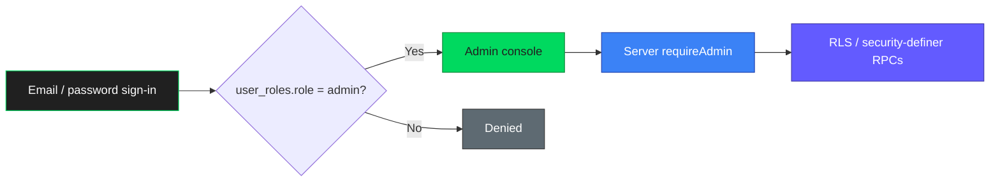

<p align="center">
  
</p>

<h1 align="center">Trackwise Admin</h1>

<p align="center">
  <strong>Internal operations console</strong><br/>
  <sub>Catalog · Users · Roles · Audit · Feature flags</sub><br/>
  <sub>Same Supabase project as the mobile app · No public signup</sub>
</p>

<p align="center">
  
  
  
  
  
</p>

<p align="center">
  <a href="#what-is-trackwise-admin"></a>
  <a href="#modules"></a>
  <a href="#getting-started"></a>
  <a href="#configuration"></a>
  <a href="../README.md"></a>
</p>

---

## What is Trackwise Admin?

Standalone **Next.js App Router** console for operators. It shares Auth users and Postgres with the Expo mobile app. Only accounts with an `admin` row in `public.user_roles` can sign in.

|                                                                                                                                     |                                                                                                                                       |                                                                                                                                   |                                                                                                                                 |
| ----------------------------------------------------------------------------------------------------------------------------------- | ------------------------------------------------------------------------------------------------------------------------------------- | --------------------------------------------------------------------------------------------------------------------------------- | ------------------------------------------------------------------------------------------------------------------------------- |
|  Invite / promote admins only |  Privilege via `user_roles`, not metadata |  Foods & exercises with soft-archive |  Role and suspension actions logged |

> **Not** the public marketing site — that lives in [`../dashboard`](../dashboard/README.md) on port **3001**.

---

## Modules

|                                                                                    | Module           | Highlights                                                                                          |
| :--------------------------------------------------------------------------------: | ---------------- | --------------------------------------------------------------------------------------------------- |
|  | **Dashboard**    | User counts, engagement proxies from food/workout writes, catalog totals                            |
|                 | **Exercises / Foods** | System catalog CRUD, soft-archive (`archived_at`), exercise images → Storage `exercise-images` |
|  | **Users**      | Roles (`admin` / `tester`), suspend / restore, audit-backed RPCs (`admin_set_role`, …)              |
|                    | **User data**    | Read-only food logs, workouts, measurements, goals, templates                                       |
|                  | **System**       | Feature flags, audit log viewer, catalog health                                                     |

**Important product rules**

- Food entry macros/names are **snapshots** — catalog edits must not rewrite diary history
- Engagement KPIs are **proxies** from food/workout activity; do not invent session DAU
- Soft-archive catalog rows when foreign keys exist; prefer additive migrations

---

## How access works



- Auth: `@supabase/ssr` cookie sessions (email/password)
- Authorization: `public.user_roles` + `is_admin()` / security-definer RPCs — **never** trust `user_metadata` for privilege
- Catalog and Storage writes run only after `requireAdmin()` on the server

---

## Tech stack

| Layer        | Choice                                      |
| ------------ | ------------------------------------------- |
| **App**      | Next.js 15 (App Router), React 19, TypeScript |
| **UI**       | Tailwind CSS v4, Lucide, Recharts           |
| **Data**     | Supabase JS + SSR clients                   |
| **Auth gate**| `src/lib/auth.ts` → `requireAdmin()`        |
| **Schema**   | `../supabase/migrations/`                   |
| **Tests**    | Vitest                                      |

**Expand** `src/` layout

```text
src/
├── app/                 # Routes (dashboard, catalog, users, system, …)
├── features/            # Domain actions & queries
└── lib/
    ├── auth.ts          # requireAdmin gate
    └── supabase/        # Browser / server / service-role clients
```

---

## Getting started

### Requirements

- **Node.js 20+** and **npm**
- Same Supabase project as mobile (local Docker or hosted)
- Migration `20261102220000_admin_roles_and_security.sql` applied (and related admin schema)

### Install & run

```bash
cd admin
cp .env.example .env.local   # if present; otherwise create .env.local from the template below
npm install
npm run dev                  # http://localhost:3000
```

| Script | Purpose |
| ------ | ------- |
| `npm run dev` | Development server (port 3000) |
| `npm run build` / `npm start` | Production build & serve |
| `npm run lint` | ESLint |
| `npm run typecheck` | TypeScript |
| `npm test` | Vitest |

### Bootstrap the first admin

`public.user_roles` is **read-only in the Table Editor** for normal clients (RLS: select only). Role writes go through RPCs / SQL as **postgres** or **service_role** — not manual row edits with the anon key.

Until at least one admin exists, run **once** (SQL Editor → role `postgres`, or `psql`), replacing the UUID with your Auth user id:

```sql
select public.admin_bootstrap_grant('00000000-0000-0000-0000-000000000000');
```

**Local seed** (`supabase/seed.sql`, applied on `db reset`):

| | |
| - | - |
| Email | `test@admin.com` |
| Password | `testadmin` |
| Role | `admin` |

After bootstrap, promote/demote via **Admin → Users** (`admin_set_role`). The **last** admin cannot be demoted.

### Sync system exercise content (local)

After migrations, local catalog rows may still be stubs. From the **repo root**, with local Supabase env available:

```bash
npm run sync:exercises
```

Upserts coaching copy, sets `image_key` / `image_storage_path`, and uploads art from `assets/images/workout/exercises/` into the `exercise-images` bucket.

---

## Configuration

Create `admin/.env.local`:

```env
# ── Supabase (same project as mobile) ──────────────────────────────
NEXT_PUBLIC_SUPABASE_URL=https://YOUR_PROJECT.supabase.co
NEXT_PUBLIC_SUPABASE_PUBLISHABLE_KEY=your_publishable_key

# Server-only — Auth Admin email lookup. Never expose as NEXT_PUBLIC_*.
SUPABASE_SERVICE_ROLE_KEY=your_service_role_key
```

For local Supabase, copy values from:

```bash
npx supabase status
```

| Variable | Where | Purpose |
| -------- | ----- | ------- |
| `NEXT_PUBLIC_SUPABASE_URL` | Browser + server | Project URL |
| `NEXT_PUBLIC_SUPABASE_PUBLISHABLE_KEY` | Browser + server | Publishable / anon key |
| `SUPABASE_SERVICE_ROLE_KEY` | **Server only** | Auth Admin email lookup |

Never put the service-role key in `NEXT_PUBLIC_*`, the mobile app, or client components.

---

## Deploy (Vercel)

1. Set project **Root Directory** to `admin`
2. Configure the three environment variables above
3. Do **not** enable public Auth signup on the shared Supabase project for admin onboarding

---

## Mobile entry

The Expo app shows **Account → Admin dashboard** when:

1. `EXPO_PUBLIC_ADMIN_URL` points at this deployment (e.g. `http://localhost:3000` or `https://admin.example.com`)
2. The signed-in user has `user_roles.role = 'admin'`

The link opens the browser; login is separate (**no tokens in the URL**).

---

## Related docs

| Doc | Purpose |
| --- | ------- |
| [`../README.md`](../README.md) | Mobile app + monorepo overview |
| [`../supabase/README.md`](../supabase/README.md) | Migrations, OTP templates, Edge Functions |
| [`../dashboard/README.md`](../dashboard/README.md) | Public marketing site |
| [`AGENTS.md`](./AGENTS.md) | Agent / contributor rules for this package |

---

## License

Proprietary — same terms as the Trackwise monorepo. No public open-source license is published here.

---

<div align="center">


<strong>Trackwise Admin</strong><br/>
<sub>Operate the catalog. Protect the data.</sub>

</div>
