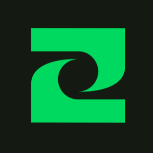

<p align="center">
  
</p>

<h1 align="center">Trackwise Dashboard</h1>

<p align="center">
  <strong>Public marketing site for trackwise.one</strong><br/>
  <sub>Product story · Features · FAQ · Support · Legal</sub><br/>
  <sub>Not the Admin console · No app backend required to run</sub>
</p>

<p align="center">
  <a href="https://trackwise.one"></a>
  <a href="http://localhost:3001"></a>
</p>

<p align="center">
  
  
  
  
  
</p>

<p align="center">
  <a href="#what-is-this-package"></a>
  <a href="#pages"></a>
  <a href="#getting-started"></a>
  <a href="#configuration"></a>
  <a href="../README.md"></a>
</p>

---

## What is this package?

The **main public web** for Trackwise — product marketing, feature detail, FAQ, support, and legal pages at [trackwise.one](https://trackwise.one).

|                                                                                                                                      |                                                                                                                                          |                                                                                                                                     |                                                                                                                                   |
| ------------------------------------------------------------------------------------------------------------------------------------ | ---------------------------------------------------------------------------------------------------------------------------------------- | ----------------------------------------------------------------------------------------------------------------------------------- | --------------------------------------------------------------------------------------------------------------------------------- |
|  Prospects & users — not operators     |  Advertise only mobile features that ship |  Empty store URLs → Coming soon |  `#00D95F` · Bricolage / Geist / Mono |

This package is **separate** from:

| Package | Role | Port |
| ------- | ---- | ---- |
| [`../`](../README.md) (repo root) | Expo mobile app | Metro |
| [`../admin`](../admin/README.md) | Internal Admin console | **3000** |
| **`dashboard/`** (this package) | Public marketing site | **3001** |

It does **not** need the mobile app or Admin console running.

---

## Pages

| Route | Purpose |
| ----- | ------- |
| `/` | Marketing homepage (hero, features, how it works, FAQ, download) |
| `/features` | Deeper feature overview |
| `/about` | Short about page |
| `/support` | Support Center |
| `/feedback` | Feedback form (Resend → support email via `/api/feedback`) |
| `/privacy` | Privacy Policy |
| `/terms` | Terms of Use |

**Product messaging defaults**

- Free core tracking on **Android** first; **iOS later**
- Barcode scan = Open Food Facts lookup — **not** AI meal recognition / OCR
- Calorie and activity values are **estimates**, not medical measurements

---

## Tech stack

| Layer | Choice |
| ----- | ------ |
| **App** | Next.js 15 (App Router), React 19, TypeScript |
| **UI** | Tailwind CSS v4, Lucide |
| **Fonts** | Bricolage Grotesque (display), Geist (body), JetBrains Mono (metrics) |
| **i18n** | Client locale dictionaries — EN / FI / SV / VI |
| **Theme** | Light / dark / system (CSS variables + `data-theme`) |
| **Config** | `src/config/site.ts` (hard-coded public constants) |

**Expand** `src/` layout

```text
public/images/               # Screenshots, branding
src/
├── app/                     # Routes (/, /features, /privacy, …)
├── components/
│   ├── layout/              # Shell, footer
│   ├── navigation/          # Header, locale + theme controls
│   ├── mockups/             # Phone frames & screen previews
│   └── sections/            # Homepage sections
├── config/site.ts           # Domain, store URLs, support contact
├── content/                 # FAQ, features, legal, support copy
└── i18n/                    # Locale messages + provider
```

Design reference: [`../DESIGN.MD`](../DESIGN.MD) and root [`AGENTS.md`](../AGENTS.md).

---

## Getting started

### Requirements

- **Node.js 20+** and **npm**
- No Supabase or Docker required for local marketing preview

### Install & run

```bash
cd dashboard
cp .env.example .env.local
npm install
npm run dev                  # http://localhost:3001
```

Port **3001** avoids colliding with Admin on **3000**.

| Script | Purpose |
| ------ | ------- |
| `npm run dev` | Development server on port 3001 |
| `npm run build` | Production build |
| `npm run start` | Serve production build on port 3001 |
| `npm run lint` | ESLint |
| `npm run typecheck` | TypeScript (`tsc --noEmit`) |

---

## Configuration

Edit **`src/config/site.ts`** — no Vercel env required for contact/store/SEO:

| Constant | Purpose |
| -------- | ------- |
| `SITE_URL` / `SITE_DOMAIN` | Canonical origin |
| `SUPPORT_EMAIL` / `SUPPORT_PHONE` | Public support contact |
| `GOOGLE_PLAY_URL` | Android store (empty → Coming soon) |
| `APP_STORE_URL` | iOS store when live |

**Feedback email (server env in `.env.local`, see `.env.example`)**

| Variable | Purpose |
| -------- | ------- |
| `RESEND_API_KEY` | Resend API key for `/api/feedback` |
| `RESEND_FROM` | Optional From address (default `Trackwise <onboarding@resend.dev>`) |

With the default From, Resend only delivers to the email on your Resend account. For production, verify `trackwise.one` in Resend and set `RESEND_FROM` to an address on that domain.

Brand assets are mirrored from `../assets/images/branding/` into `public/images/branding/`.

---

## Content & honesty rules

- Advertise only features that exist in the **shipping mobile app**
- Prefer **Coming soon** over invented AI or unpaid store claims; do not leave visible TODO copy on pages
- Empty store URLs in `site.ts` must not create broken links

---

## Deploy

Typical Vercel setup:

1. **Root Directory** = `dashboard`
2. Confirm `src/config/site.ts` (especially store URLs when published)
3. Do not wire DNS, store URLs, or production backends without owner approval

---

## Related docs

| Doc | Purpose |
| --- | ------- |
| [`../README.md`](../README.md) | Mobile app + monorepo overview |
| [`../admin/README.md`](../admin/README.md) | Internal Admin console |
| [`AGENTS.md`](./AGENTS.md) | Agent / contributor rules for this package |
| [`../DESIGN.MD`](../DESIGN.MD) | Visual system |

---

## License

Proprietary — same terms as the Trackwise monorepo. No public open-source license is published here.

---

<div align="center">


<strong>Trackwise</strong><br/>
<sub>Make every step count.</sub>

<br/>

<a href="https://trackwise.one"></a>

</div>
